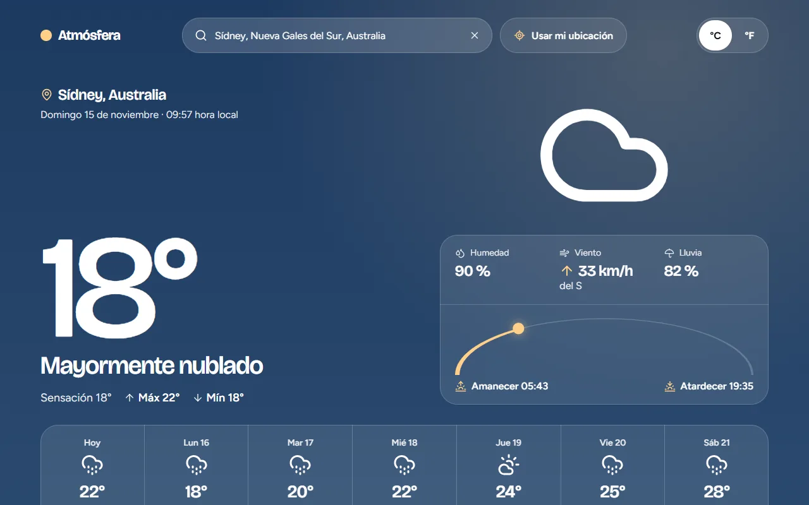
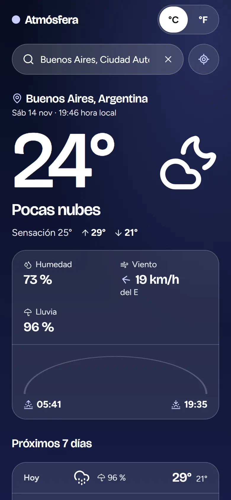
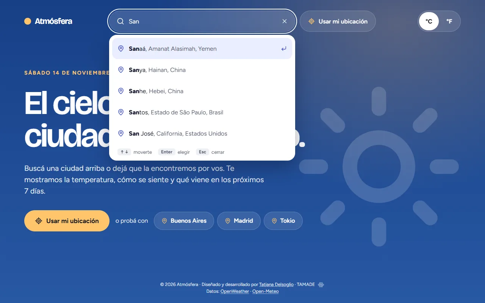
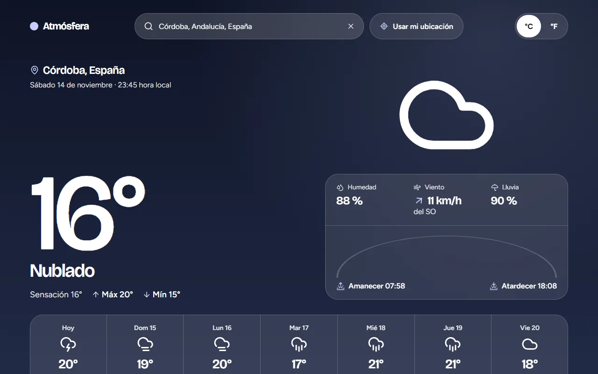
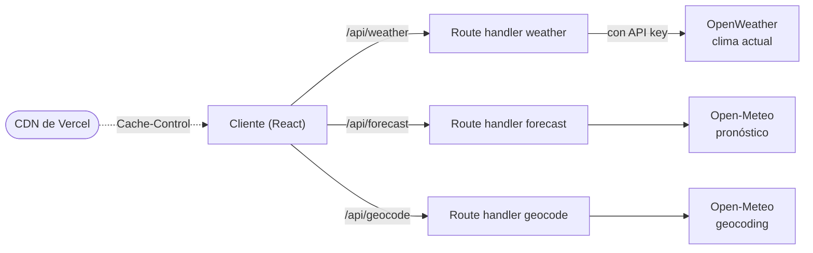
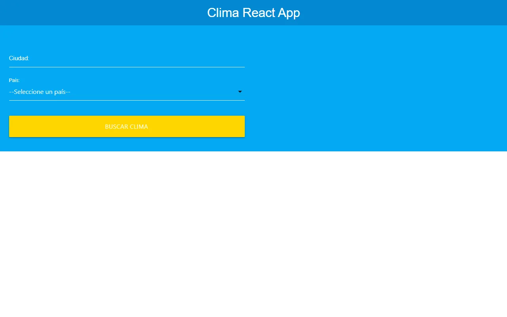
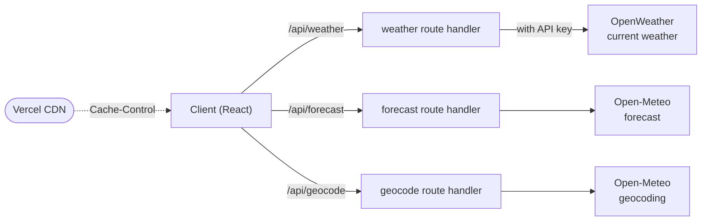

<div align="center">

# Atmósfera

**[Español](#español) | [English](#english)**

</div>

---

<a id="español"></a>

## Español

**Atmósfera** es una app del clima con un cielo que cambia según la condición y la hora local de la ciudad que buscás.

[](https://github.com/tatianadelsoglio/climaweb/actions/workflows/ci.yml)
[](https://nextjs.org)
[](https://www.typescriptlang.org)

**Demo: <https://atmosfera-psi.vercel.app/>**





### Qué hace

- **Autocompletado** de ciudades mientras escribís, con navegación por teclado.
- **Geolocalización**: botón «Usar mi ubicación».
- **Cielos dinámicos**: 8 cielos (despejado, nublado, lluvia, tormenta, nieve, neblina; los dos primeros en versión día y noche) según la condición y la hora local **de la ciudad buscada**, no la del dispositivo.
- **Pronóstico de 7 días** con probabilidad de lluvia, mínima y máxima.
- **°C / °F**, y la unidad elegida se recuerda en el navegador.
- **Accesibilidad pensada para WCAG 2.1 AA**: contrastes verificados contra los 8 cielos, foco visible, áreas táctiles de 44 px o más en los controles principales, combobox con ARIA y región `aria-live` para anunciar resultados.





### Stack y por qué

| Tecnología | Por qué |
| --- | --- |
| Next.js 16 (App Router) | Route handlers para el proxy server-side y frontend en el mismo proyecto, deploy directo en Vercel. |
| React 19 | Componentes y hooks; la lógica de datos vive en hooks y `lib/`, no en la UI. |
| TypeScript estricto | Contratos tipados entre las rutas de la API, los proveedores y la UI. |
| Tailwind CSS 4 | Tokens del diseño (colores, espaciados, cielos) definidos una sola vez en `globals.css`. |
| `next/font` (Bricolage Grotesque + Figtree) | Tipografías del diseño, autoalojadas y sin saltos de layout. |
| Lucide | Íconos consistentes y livianos, los mismos del diseño. |
| Vitest + Testing Library | Tests rápidos de lógica pura, rutas de la API (con `fetch` simulado), hooks y componentes. |
| GitHub Actions | Lint, tipos, tests y build en cada push y PR a `main`. |

### Arquitectura y decisiones



- **Proxy server-side.** El navegador nunca habla con los proveedores: llama a `/api/weather`, `/api/forecast` y `/api/geocode`. La `OPENWEATHER_API_KEY` vive solo en el servidor. Las rutas validan la entrada antes de consultar y devuelven errores con un contrato único.
- **Dos proveedores.** OpenWeather entrega el clima actual (condición, sensación, humedad, viento, amanecer y atardecer). Open-Meteo entrega el pronóstico diario y el geocoding con búsqueda por prefijo, necesario para el autocompletado, y no requiere API key.
- **Caché por tipo de dato, en dos niveles.** Clima actual 10 min, pronóstico 30 min y geocoding 24 h, tanto en la caché de datos de Next (clave: la URL normalizada del proveedor) como en el CDN (`s-maxage` + `stale-while-revalidate`). Es la protección principal de la cuota de los proveedores.
- **Rate limit por IP, de mejor esfuerzo.** Cubo de fichas por IP y por ruta. En serverless el estado vive en la memoria de cada instancia, así que el límite es **por instancia, no global**: frena abusos evidentes y nada más. Pasar a uno global (Redis/Upstash) implica cambiar una línea en `almacenLimite.ts`.
- **Día y noche según la ciudad.** Se compara la hora local de la ciudad (con su huso horario) contra su amanecer y atardecer. Cuando falta un horario utilizable (sol de medianoche o noche polar), se decide por la elevación aproximada del sol calculada con las coordenadas, y como último recurso por horas fijas.

### Calidad

- **313 tests** en 26 archivos con Vitest (lógica de cielos y horario solar, validaciones, caché, rate limit, rutas de la API, hooks y componentes).
- **CI** en GitHub Actions: lint, typecheck, tests y build.
- **Lighthouse** sobre la demo en producción ([atmosfera-psi.vercel.app](https://atmosfera-psi.vercel.app/), pantalla inicial, Lighthouse 13.6.0, medido el 14/11/2026):

| Dispositivo | Performance | Accessibility | Best Practices | SEO |
| --- | :---: | :---: | :---: | :---: |
| Mobile | 90 | 100 | 100 | 100 |
| Desktop | 100 | 100 | 100 | 100 |

### Proceso de diseño

Antes de escribir código exploré dos direcciones visuales en [pen.dev](https://pen.dev) (archivo [`design/climaweb.pen`](design/climaweb.pen)). Elegí la dirección **«Atmósfera»**: un cielo de fondo que comunica la condición y la hora de un vistazo, paneles de vidrio, tipografía grande y una paleta con contraste verificado para texto y vidrio sobre cada cielo. De ahí salieron los tokens que usa Tailwind y los 8 cielos.

<!-- TODO(Tatiana): describir la otra dirección explorada y por qué se descartó. -->

### Antes y después

La primera versión es de 2021 y quedó marcada con el tag [`v1-2021`](https://github.com/tatianadelsoglio/climaweb/tree/v1-2021).

| | 2021 | Hoy |
| --- | --- | --- |
| Stack | Create React App, React 17, JavaScript | Next.js 16, React 19, TypeScript estricto, Tailwind 4 |
| API key | Escrita en el código del cliente | Solo en el servidor, detrás de un proxy |
| Búsqueda | Ciudad en texto y país en un `<select>`, un clic en «Buscar Clima» | Un solo campo con autocompletado, geolocalización y teclado |
| Datos | Respuesta cruda de OpenWeather | Clima actual + pronóstico de 7 días, °C/°F |
| Visual | Fondo celeste fijo | 8 cielos según condición y hora local |
| Calidad | Sin tests propios | 313 tests, CI y Lighthouse |



_Captura de la versión de 2021 levantada desde el tag `v1-2021`: solo se muestra el formulario porque la API key de esa versión ya no es válida._

### Cómo correrlo localmente

**Requisitos:** Node.js ≥ 22.18 (hay un `.nvmrc`) y una API key gratuita de OpenWeather.

```bash
git clone https://github.com/tatianadelsoglio/climaweb.git
cd climaweb
npm install
cp .env.example .env.local   # y completá OPENWEATHER_API_KEY
npm run dev                  # http://localhost:3000
```

**Variables de entorno**

| Variable | Obligatoria | Descripción |
| --- | :---: | --- |
| `OPENWEATHER_API_KEY` | Sí | Key de OpenWeather para el clima actual. Se consigue gratis en <https://home.openweathermap.org/api_keys>. Open-Meteo no necesita key. |

**Scripts**

| Script | Qué hace |
| --- | --- |
| `npm run dev` | Servidor de desarrollo |
| `npm run build` | Build de producción |
| `npm start` | Sirve el build de producción |
| `npm run lint` | ESLint |
| `npm run typecheck` | Genera los tipos de Next y corre `tsc --noEmit` |
| `npm test` | Tests con Vitest (una corrida) |
| `npm run test:watch` | Vitest en modo watch |

### Próximos pasos

Lo que todavía no está hecho:

- Rate limit global (hoy es por instancia).
- Tests end-to-end en un navegador real: los actuales son unitarios, de rutas y de componentes.
- Auditoría de accesibilidad manual con lectores de pantalla; hoy hay verificación de contrastes y Lighthouse, no una auditoría formal.
- Interfaz en un solo idioma (español).
- Pronóstico por hora.
- Definir una licencia para el código.

### Créditos y atribución

- Clima actual: [OpenWeather](https://openweathermap.org).
- Pronóstico y geocoding: [Open-Meteo](https://open-meteo.com), bajo licencia [CC BY 4.0](https://creativecommons.org/licenses/by/4.0/).
- Íconos: [Lucide](https://lucide.dev).
- Tipografías: Bricolage Grotesque y Figtree, de Google Fonts.

### Autora

**Tatiana Delsoglio**: diseño y desarrollo.

[GitHub](https://github.com/tatianadelsoglio) · [LinkedIn](https://www.linkedin.com/in/tatiana-delsoglio/)


[↑ Volver arriba](#atmósfera)

---

<a id="english"></a>

## English

**Atmósfera** is a weather app whose sky changes with the condition and the local time of the city you search for.

[](https://github.com/tatianadelsoglio/climaweb/actions/workflows/ci.yml)
[](https://nextjs.org)
[](https://www.typescriptlang.org)

**Demo: <https://atmosfera-psi.vercel.app/>** (the interface is in Spanish)


### What it does

- **Autocomplete** for cities as you type, with keyboard navigation.
- **Geolocation**: a "Use my location" button.
- **Dynamic skies**: 8 skies (clear, cloudy, rain, storm, snow, mist; the first two in day and night versions) driven by the condition and the local time **of the searched city**, not the device's.
- **7-day forecast** with chance of rain, minimum and maximum.
- **°C / °F**, and the chosen unit is remembered in the browser.
- **Accessibility designed for WCAG 2.1 AA**: contrast checked against all 8 skies, visible focus, touch targets of 44 px or more on the main controls, an ARIA combobox and an `aria-live` region to announce results.


### Stack and why

| Technology | Why |
| --- | --- |
| Next.js 16 (App Router) | Route handlers for the server-side proxy and the frontend in one project, straightforward deploy on Vercel. |
| React 19 | Components and hooks; data logic lives in hooks and `lib/`, not in the UI. |
| Strict TypeScript | Typed contracts between the API routes, the providers and the UI. |
| Tailwind CSS 4 | Design tokens (colors, spacing, skies) defined once in `globals.css`. |
| `next/font` (Bricolage Grotesque + Figtree) | The design's typefaces, self-hosted and without layout shift. |
| Lucide | Consistent, lightweight icons, the same ones used in the design. |
| Vitest + Testing Library | Fast tests for pure logic, API routes (with a mocked `fetch`), hooks and components. |
| GitHub Actions | Lint, types, tests and build on every push and PR to `main`. |

### Architecture and decisions



- **Server-side proxy.** The browser never talks to the providers: it calls `/api/weather`, `/api/forecast` and `/api/geocode`. `OPENWEATHER_API_KEY` lives only on the server. The routes validate input before querying and return errors with a single contract.
- **Two providers.** OpenWeather supplies the current weather (condition, feels-like, humidity, wind, sunrise and sunset). Open-Meteo supplies the daily forecast and the geocoding with prefix search, which autocomplete needs, and it requires no API key.
- **Cache per data type, on two levels.** Current weather 10 min, forecast 30 min and geocoding 24 h, both in Next's data cache (key: the normalized provider URL) and at the CDN (`s-maxage` + `stale-while-revalidate`). This is the main protection for the providers' quota.
- **Per-IP rate limit, best effort.** A token bucket per IP and per route. On serverless the state lives in each instance's memory, so the limit is **per instance, not global**: it stops obvious abuse and nothing more. Moving to a global one (Redis/Upstash) means changing one line in `almacenLimite.ts`.
- **Day and night based on the city.** The city's local time (using its time zone offset) is compared against its sunrise and sunset. When no usable schedule exists (midnight sun or polar night), it falls back to the approximate sun elevation computed from the coordinates, and finally to fixed hours.

### Quality

- **313 tests** across 26 files with Vitest (sky and solar schedule logic, validation, cache, rate limit, API routes, hooks and components).
- **CI** on GitHub Actions: lint, typecheck, tests and build.
- **Lighthouse** against the production demo ([atmosfera-psi.vercel.app](https://atmosfera-psi.vercel.app/), landing screen, Lighthouse 13.6.0, measured on 2026-11-14):

| Device | Performance | Accessibility | Best Practices | SEO |
| --- | :---: | :---: | :---: | :---: |
| Mobile | 90 | 100 | 100 | 100 |
| Desktop | 100 | 100 | 100 | 100 |

### Design process

Before writing code I explored two visual directions in [pen.dev](https://pen.dev) (file [`design/climaweb.pen`](design/climaweb.pen)). I chose the **"Atmósfera"** direction: a background sky that conveys condition and time at a glance, glass panels, large type and a palette with verified contrast for text and glass over every sky. The Tailwind tokens and the 8 skies come from it.

<!-- TODO(Tatiana): describe the other direction explored and why it was discarded. -->

### Before and after

The first version dates from 2021 and is tagged [`v1-2021`](https://github.com/tatianadelsoglio/climaweb/tree/v1-2021).

| | 2021 | Today |
| --- | --- | --- |
| Stack | Create React App, React 17, JavaScript | Next.js 16, React 19, strict TypeScript, Tailwind 4 |
| API key | Written in the client code | Server-only, behind a proxy |
| Search | City as text and country in a `<select>`, one click on "Buscar Clima" | A single field with autocomplete, geolocation and keyboard support |
| Data | Raw OpenWeather response | Current weather + 7-day forecast, °C/°F |
| Visuals | Fixed light-blue background | 8 skies based on condition and local time |
| Quality | No tests of its own | 313 tests, CI and Lighthouse |


_Screenshot of the 2021 version run from the `v1-2021` tag: only the form is shown because that version's API key is no longer valid._

### Running it locally

**Requirements:** Node.js ≥ 22.18 (there is an `.nvmrc`) and a free OpenWeather API key.

```bash
git clone https://github.com/tatianadelsoglio/climaweb.git
cd climaweb
npm install
cp .env.example .env.local   # then fill in OPENWEATHER_API_KEY
npm run dev                  # http://localhost:3000
```

**Environment variables**

| Variable | Required | Description |
| --- | :---: | --- |
| `OPENWEATHER_API_KEY` | Yes | OpenWeather key for current weather. Get one for free at <https://home.openweathermap.org/api_keys>. Open-Meteo needs no key. |

**Scripts**

| Script | What it does |
| --- | --- |
| `npm run dev` | Development server |
| `npm run build` | Production build |
| `npm start` | Serves the production build |
| `npm run lint` | ESLint |
| `npm run typecheck` | Generates Next types and runs `tsc --noEmit` |
| `npm test` | Vitest tests (single run) |
| `npm run test:watch` | Vitest in watch mode |

### Next steps

What is not done yet:

- A global rate limit (today it is per instance).
- End-to-end tests in a real browser: the current ones are unit, route and component tests.
- A manual accessibility audit with screen readers; today there is contrast verification and Lighthouse, not a formal audit.
- The interface is in a single language (Spanish).
- Hourly forecast.
- Choosing a license for the code.

### Credits and attribution

- Current weather: [OpenWeather](https://openweathermap.org).
- Forecast and geocoding: [Open-Meteo](https://open-meteo.com), licensed under [CC BY 4.0](https://creativecommons.org/licenses/by/4.0/).
- Icons: [Lucide](https://lucide.dev).
- Typefaces: Bricolage Grotesque and Figtree, from Google Fonts.

### Author

**Tatiana Delsoglio**: design and development.

[GitHub](https://github.com/tatianadelsoglio) · [LinkedIn](https://www.linkedin.com/in/tatiana-delsoglio/)


[↑ Back to top](#atmósfera)
